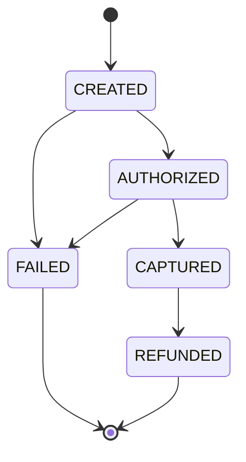

# Mini Payment Orchestrator

A payment orchestration service written in Go with **zero external dependencies**. It focuses on the correctness problems that matter in payments: idempotent requests, safe state transitions under concurrency, provider failover, and webhook handling.

> Portfolio project. The store is in-memory by design (see [Known limitations](#known-limitations)); the interfaces are built so a real database can replace it.

## Features

- **Idempotent `POST /payments`**: repeating a request with the same `Idempotency-Key` replays the original response instead of creating a second payment.
- **Payment state machine**: a pure transition function; illegal transitions are rejected.
- **Optimistic locking**: updates carry an expected version, so concurrent writers cannot silently overwrite each other.
- **Routing with failover**: a sliding-window success-rate strategy picks a provider, with a circuit breaker (closed / open / half-open) and a retry-and-fallback loop.
- **Webhook handling**: deduplicated by event ID; stale or out-of-order events are acknowledged but do not change state.
- **Observability**: request-ID propagation, JSON structured logs, and a `/metrics` endpoint.

## Architecture

```text
HTTP Client
    |
    v
[ RequestID Middleware ]  -> trace propagation
[ Logging Middleware   ]  -> JSON structured logs
    |
    v
Router (net/http mux)
  POST /payments       -> PaymentHandler
  POST /webhooks/{p}   -> WebhookHandler
  GET  /metrics        -> Metrics registry
    |                        |
    v                        v
Idempotency KeyLocker    State machine (pure transition function)
    |                        |
    v                        v
Store interface (MemoryStore)
  Create, Get
  Update (optimistic locking via version)
  SaveIdempotencyKey, GetIdempotencyKey
  SaveWebhookEvent
    |
    v
Routing layer
  SlidingWindowStrategy, CircuitBreaker, retry + fallback
    |
    v
ProviderAdapter interface
  Provider A (mock), Provider B (mock)
```

## Payment state machine



`FAILED` and `REFUNDED` are terminal. Only full refunds are supported.

## Design decisions

| # | Decision | Alternative considered | Why |
|---|----------|------------------------|-----|
| 1 | Go standard-library mux | chi, gin | Go 1.22 supports method and path patterns, so no dependency is needed. |
| 2 | In-memory store behind an interface | Postgres | The interface is the contract; swapping in Postgres should touch only the store implementation. |
| 3 | Optimistic locking with an expected version | Pessimistic row locks | Maps directly to `UPDATE ... WHERE version = $1` and prevents lost updates without database-specific locking. |
| 4 | In-process `KeyLocker` for idempotency | Unique constraint plus retry | A second concurrent request waits and replays the first response instead of failing. Within one process this avoids duplicate provider calls. Across processes, a database unique constraint is still required (see scaling notes). |
| 5 | Circuit breaker with half-open probing | Retrying a dead provider | Fails fast when a provider is down and limits probe traffic while it recovers. |
| 6 | Sliding-window success rate | Lifetime success rate | Recent behaviour matters more; a degrading provider is penalised within one window rather than after its history is diluted. |
| 7 | Webhook dedupe by event ID | Process every delivery | Providers retry webhooks; deduping prevents applying the same transition twice. |
| 8 | Return `200 OK` for stale webhooks | Return `4xx` | An error response makes providers retry indefinitely. The state machine rejects the illegal transition, and we acknowledge receipt. |
| 9 | Full refunds only | Partial refunds | Partial refunds need a ledger, rounding rules, and multiple refund events. Out of scope. |

## API

All amounts are integers in the currency's minor unit (`amount_cents`, e.g. paise for INR).

### `POST /payments`

Headers: `Idempotency-Key` (required), `Content-Type: application/json`

```bash
curl -X POST http://localhost:8080/payments \
  -H "Idempotency-Key: my-key-1" \
  -H "Content-Type: application/json" \
  -d '{"amount_cents": 5000, "currency": "INR"}'
```

Sending the same request again with the same key returns the same response, and `idempotency_cache_hits_total` increases.

### `POST /webhooks/{provider}`

Receives provider events. Duplicate event IDs and events that would cause an illegal transition are acknowledged with `200` and ignored.

### `GET /metrics`

Counters include `payments_created_total`, `provider_success_total_provider_a`, and `idempotency_cache_hits_total`.

## Running it

```bash
# Tests (the race detector needs a C compiler / cgo enabled)
go test -race ./...

# Start the server on :8080
go run ./cmd/server

# Check metrics
curl http://localhost:8080/metrics
```

## Known limitations

Being explicit about these is deliberate; each one is a real production concern.

- **No durability.** State lives in memory and is lost on restart. A crash between a provider call and persisting the result would lose the outcome.
- **Ambiguous outcomes.** A provider timeout does not tell us whether the charge happened. Treating it as a plain failure and falling back to another provider could double-charge.
- **Synchronous payments only.** There is no `PENDING` state, so asynchronous flows (UPI collect, 3-D Secure redirects) are not modelled.
- **Routing is exploit-only.** The sliding window always favours the current best provider, with no exploration, no cold-start handling, and no context such as payment method, bank, or amount.
- **Webhook trust.** Signature verification and out-of-order delivery beyond the state machine's checks are not handled.

## Roadmap

1. Pass an idempotency key to providers on every attempt, add an `UNKNOWN`/`PENDING` state, and reconcile ambiguous outcomes.
2. Persist an intent record before calling a provider; replace `MemoryStore` with Postgres.
3. Reject reuse of an `Idempotency-Key` with a different request payload.
4. Classify provider errors (retryable vs. hard decline) and add backoff with jitter.
5. HMAC signature verification for webhooks.
6. Exploration-based routing (Thompson sampling) and a benchmark against Hyperswitch's open-source routing service, with results documented here.

## At production scale

1. **Idempotency as a database constraint.** A unique constraint on `(merchant_id, idempotency_key)`, with the stored response replayed on conflict, is the source of truth. The in-process locker becomes an optimisation. Keys are scoped per merchant.
2. **Transactional outbox.** Write the payment state and an outbox row in one database transaction, then publish to Kafka from the outbox. State is never acknowledged before it is durable.
3. **Append-only transition log.** Record every state transition for an auditable history.
4. **Partitioning.** Shard by merchant or payment ID, keeping an idempotency-key lookup path that resolves to the same shard.
5. **Reconciliation.** A periodic job compares our records with provider settlement data to resolve unknown outcomes.

## Project layout

```text
cmd/server/   entry point
internal/     domain, store, idempotency, routing, handlers, metrics
```
